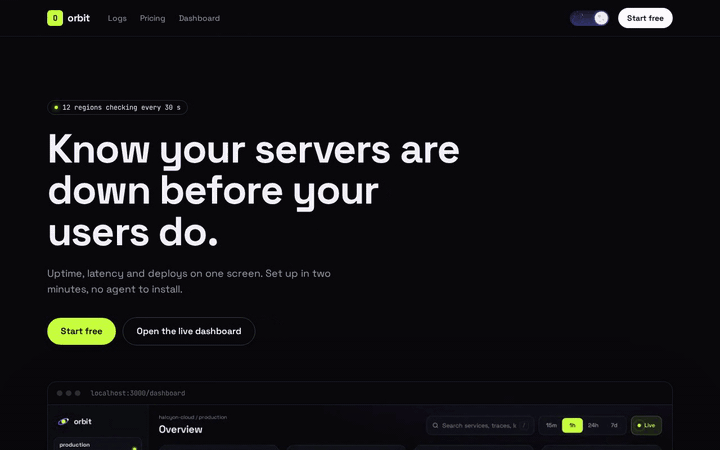
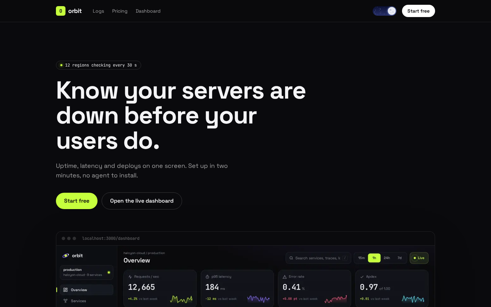
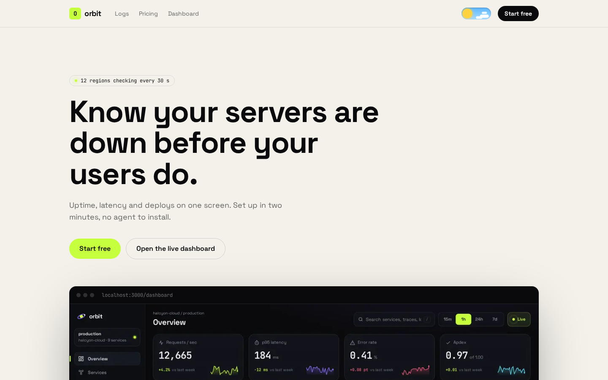
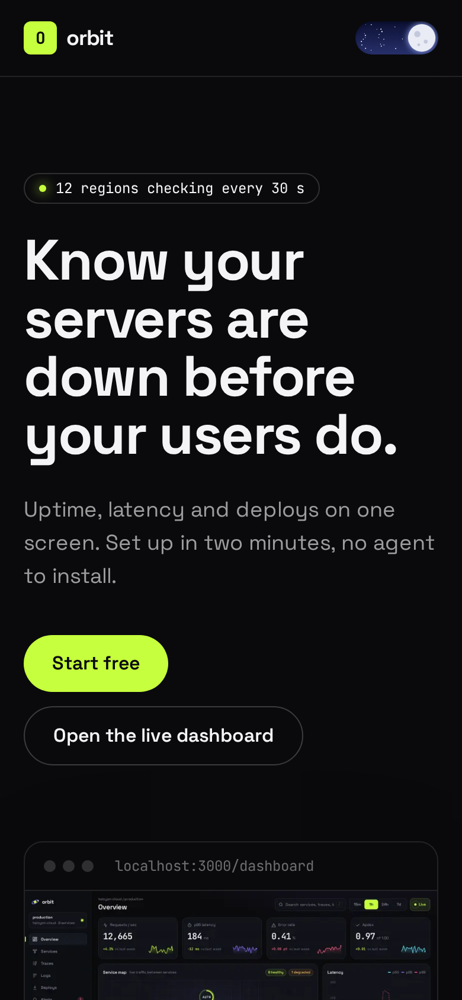

# qodesign-next-starter

A landing page and a dashboard for **Next.js 15 (App Router) + Tailwind CSS v4**, put together from the free animated components in [qodesign-free](https://github.com/teodoravadani/qodesign-free). Clone it when your v0 or Cursor build looks like every other one and you want a page with real motion and real feedback to start from.



**Live demo:** https://teodoravadani.github.io/qodesign-next-starter/

**Walkthrough:** [Make your v0 or Cursor app stop looking AI-built in 10 minutes](https://dev.to/teodoravadani/make-your-v0-or-cursor-app-stop-looking-ai-built-in-10-minutes-46jg)

[](https://vercel.com/new/clone?repository-url=https%3A%2F%2Fgithub.com%2Fteodoravadani%2Fqodesign-next-starter)

## What's in it

| Route | What you get | Components |
|---|---|---|
| `/` | Hero with a product shot, a log upload section, pricing, footer. Light and dark. | Toast Stack, Upload Dropzone, Pricing Switch, Day/Night Toggle |
| `/dashboard` | An observability dashboard with simulated live data | Orbit |

- Next.js 15.5, React 19, TypeScript, Tailwind CSS v4, Framer Motion 11. No UI kit underneath.
- Every action answers: the signup button runs a loading toast that turns into a success check, pricing buttons fire a toast, finished uploads fire a toast.
- `prefers-reduced-motion` is respected by every component and by the scroll-in on sections.
- Static pages only, so it deploys anywhere Next.js runs. `npm run build` passes with no type errors.

| Dark | Light | Phone |
|---|---|---|
|  |  |  |

## Run it

```bash
npx create-next-app@latest my-app -e https://github.com/teodoravadani/qodesign-next-starter
cd my-app
npm run dev
```

Or clone it: `git clone https://github.com/teodoravadani/qodesign-next-starter && cd qodesign-next-starter && npm install && npm run dev`.

## Make it yours

Most of this takes ten minutes:

1. **Words.** All page copy lives in `src/components/site/` (`Hero.tsx`, `Uploads.tsx`, `Pricing.tsx`, `Footer.tsx`). The product is a made-up uptime monitor called Orbit; rename it.
2. **Colours and fonts.** `src/app/globals.css` has the whole system in one `@theme` block: ink, paper, one accent (`--color-volt`), one second accent (`--color-ultra`), Space Grotesk and JetBrains Mono. Change those and the page follows.
3. **Product shot.** Replace `src/assets/dashboard.webp` with a screenshot of your own app. Any size works; `next/image` reads the dimensions.
4. **Signup.** `createWorkspace` in `Hero.tsx` is a fake promise. Point it at your API and `toast.promise` shows loading, success and error for you.
5. **Pricing.** Edit the `plans` array in `Pricing.tsx`. `onSelect(plan, yearly)` is where your checkout goes.
6. **Uploads.** Without an `upload` prop the dropzone simulates progress. Pass your uploader (the signature is in the [Upload Dropzone README](https://github.com/teodoravadani/qodesign-free/tree/main/components/upload-dropzone)) and it shows real progress, errors and retry.

## Add more components

The components are copied into `src/components/` the same way the shadcn CLI copies them, so you own the code. To pull another one from the free registry:

```bash
npx shadcn@latest add https://teodoravadani.github.io/qodesign-free/r/ledger-dashboard.json
```

Free registry items: `toast-stack`, `pricing-switch`, `upload-dropzone`, `day-night-toggle`, `orbit-dashboard`, `ledger-dashboard`.

## Files

```
src/
  app/
    layout.tsx          theme script, <Toaster />
    globals.css         Tailwind v4 + @theme tokens + fonts
    page.tsx            the landing page
    dashboard/page.tsx  Orbit
  components/
    site/               page sections (edit these)
    toast-stack/        free qodesign components (MIT)
    pricing-switch/
    upload-dropzone/
    day-night-toggle/
    orbit/
  assets/dashboard.webp product shot in the hero
```

## Notes

- The component CSS asks for Space Grotesk, JetBrains Mono and Saira Condensed by name, so `globals.css` loads them from Google Fonts with one `@import`. If you self-host fonts, keep those family names.
- Theme choice is saved in `localStorage`. A tiny inline script in `layout.tsx` applies it before paint, so there's no flash.
- The live demo is a static export: `PAGES_BASE_PATH=/qodesign-next-starter npm run build` writes `out/`. Plain `npm run build` ignores that and builds normally.

## License

MIT, for the starter and for the components in it.

## Who made this

I'm Teodor, and I make animated UI components at qodesign. The components here are the free ones. The paid ones are $3 each or $29 for all of them, with a React + Tailwind version and a prompt file for Cursor or v0, at [qodesign.dev](https://qodesign.dev/?utm_source=github&utm_medium=readme&utm_campaign=next_starter).
